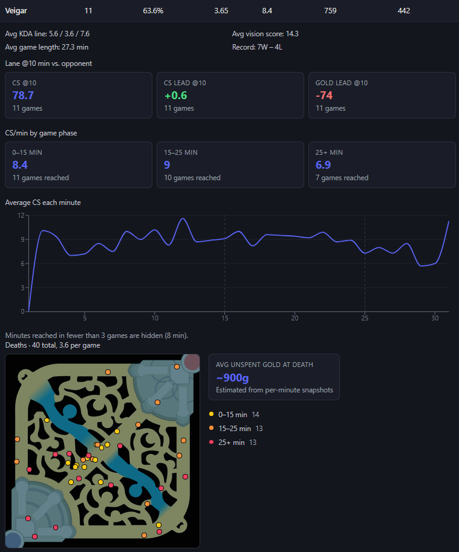

# Champion Performance Tracker

**Live site:** https://champion-performance-tracker.onrender.com
(free hosting: the first load after a quiet period can take ~30–60s)

Enter any League of Legends Riot ID and see how that player performs on each
champion they play, from overall win rate down to how much CS they're getting
at each stage of the game.



## Features

- **Individual champion stats** from the player's last 50 ranked and normal draft games: win rate, KDA,
  CS/min, damage/min, gold/min, vision score. Sortable by any column.
- **CS by game phase:** CS/min for 0–15, 15–25, and 25+ minutes.
- **CS per minute chart:** average CS gained in each minute of the game.
- **Lane leads @10:** CS and gold lead over the lane opponent at 10 minutes.
- **Death map:** every death plotted on the Summoner's Rift minimap, colored
  by game phase, with who got the kill.
- **Unspent gold at death:** an estimate of how much gold the player was
  carrying when they died.

## How it works

```
Riot ID  -->  Account-V1 (PUUID)  -->  Match-V5 match ids (last 50 per queue:
                                         draft, solo/duo, flex; newest 50 kept)
                                              |
                                  Match-V5 match details (concurrent)
                                              |
                       per-champion stats  -->  React dashboard
                                              |
             expand a champion  -->  Match-V5 timelines (fetched on demand)
                                              |
                  CS phases, per-minute CS, lane leads @10, death map
```

- **Backend:** Python, FastAPI, async Riot API client (httpx) with 429
  retry handling and in-memory caching of matches and timelines.
- **Frontend:** React + TypeScript (Vite), Recharts.
- **Hosting:** one Docker container on Render. FastAPI serves both the API
  and the built frontend.

A few details worth noting:

- Only Normal Draft, Ranked Solo/Duo, and Ranked Flex games are analyzed.
  ARAM, Arena, Swiftplay, and other modes play too differently to share
  stats with Summoner's Rift draft games. The allowed queues are listed in
  `backend/app/config.py`.
- Timelines are fetched only when a champion is expanded, so the initial
  lookup stays within Riot's rate limits.
- Riot only snapshots gold once a minute, so unspent gold at death is
  estimated. It starts from the last snapshot, subtracts item purchases
  (priced from Data Dragon, crediting components already owned), adds kill
  gold, and splits the remaining income around the death, assuming that
  passive gold is the only income while dead.
- Remakes and games under 5 minutes are excluded so they don't skew
  per-minute stats.

## Known limitations

- The match cache is in memory, so it resets whenever the server restarts.
- All visitors share one Riot API key and its rate limit, so heavy
  concurrent use will be slow.
- Unspent gold uses current-patch item prices, so older games can be
  slightly off.

## Roadmap

- Persist matches in SQLite so repeat lookups don't re-hit the Riot API
- Queue requests instead of relying on 429 retries under load
- Role/queue filtering (ranked only, mid only, etc.)
- Session view: compare early- vs. late-session performance

## Running locally

Requires Python 3.12+, Node 20+, and a key from
[developer.riotgames.com](https://developer.riotgames.com/).

```bash
cd frontend && npm install && npm run build && cd ..
cd backend
python -m venv venv && venv\Scripts\activate   # macOS/Linux: source venv/bin/activate
pip install -r requirements.txt
copy .env.example .env                         # macOS/Linux: cp; then add your key
uvicorn app.main:app --port 8000
```

Open http://localhost:8000. For frontend hot reload during development, run
`npm run dev` in `frontend/` alongside the backend and use
http://localhost:5173.

---

Champion Performance Tracker isn't endorsed by Riot Games and doesn't reflect
the views or opinions of Riot Games or anyone officially involved in producing
or managing Riot Games properties. Riot Games, and all associated properties
are trademarks or registered trademarks of Riot Games, Inc.
